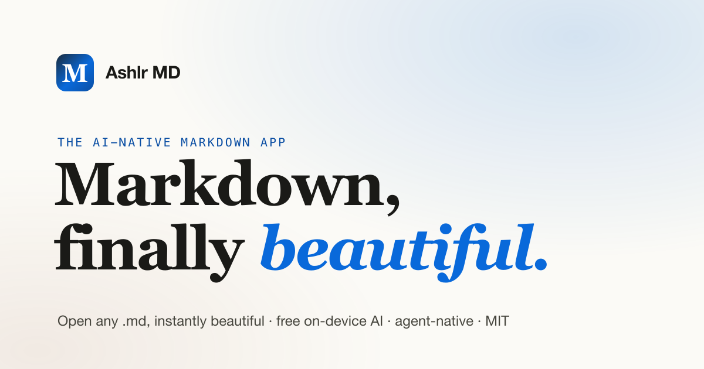

<div align="center">


# Ashlr MD

### Markdown, finally beautiful.

**An open-source, AI-native Markdown app for macOS, Windows, and Linux.** Double-click any `.md` and
it's instantly beautiful: read it, edit it, export it, and understand it with
free, private, **on-device AI** built in.

*Think Preview.app, but Markdown-aware, editable, and AI-native, and cross-platform.*

<!-- fresh:begin version-badge -->
[](https://github.com/ashlrai/ashlr-md/releases/tag/v0.4.0)
<!-- fresh:end -->

[](https://github.com/ashlrai/ashlr-md/actions/workflows/ci.yml)
[](./LICENSE)
[](#)
[](https://tauri.app)

[**Website**](https://md.ashlr.ai) ·
[Download](https://github.com/ashlrai/ashlr-md/releases) ·
[Contributing](./CONTRIBUTING.md) ·
[Roadmap](./ROADMAP.md) ·
[Vision](./docs/VISION.md)



</div>

---

## 30-second start

1. Download v0.4.0 for your OS from [Releases](https://github.com/ashlrai/ashlr-md/releases/latest): `.dmg` (Apple Silicon), `.msi`/`-setup.exe` (Windows), `.deb`/`.rpm`/`.AppImage` (Linux).
2. Double-click any `.md` file, or run `mdopen notes.md` after **Preferences → Command-line tool → Install mdopen** (the app's installers leave `mdopen` off your `PATH`; see [docs/AGENTS.md](./docs/AGENTS.md#install)).
3. Ask the AI sidebar about it. On a Mac with Apple Silicon and macOS 26 or later, the built-in on-device model needs no account and no API key: turn on Apple Intelligence in System Settings, then restart Ashlr MD. On Windows and Linux, install [Ollama](https://ollama.com) for free local AI, or add an Anthropic API key in Preferences.

## Connect your agent (MCP)

Easiest: **Preferences → AI agents (MCP) → Connect to Claude Code / Cursor**. By hand, with the bundled `mdopener-mcp`:

```bash
# Claude Code (macOS path shown; Linux: "/usr/lib/Ashlr MD/mdopener-mcp")
claude mcp add --scope user ashlr-md "/Applications/Ashlr MD.app/Contents/Resources/mdopener-mcp"
# Codex
codex mcp add ashlr-md -- "/Applications/Ashlr MD.app/Contents/Resources/mdopener-mcp"
```

Cursor (`~/.cursor/mcp.json`):

```json
{ "mcpServers": { "ashlr-md": { "command": "/Applications/Ashlr MD.app/Contents/Resources/mdopener-mcp" } } }
```

Windows path: `%LOCALAPPDATA%\Ashlr MD\mdopener-mcp.exe`. More in [docs/AGENTS.md](./docs/AGENTS.md).
The Settings copy command targets a Unix shell on macOS/Linux and PowerShell on
Windows; its quoting is not intended for Windows Command Prompt (`cmd.exe`).


## Why

Your AI agents write Markdown all day: `README.md`, `PLAN.md`, research dumps.
On most systems those open as a wall of raw syntax (TextEdit, Notepad) or a blank
page (Preview). No app owns the simple job of making them *look right* instantly,
especially for non-technical people. Ashlr MD does exactly that, on every platform.

## Features

- **Instant, beautiful rendering**: GFM, Shiki-highlighted code, Mermaid
  diagrams, KaTeX math, GitHub-style callouts, tables, footnotes.
- **Edit without the syntax**: Typora-style WYSIWYG (Milkdown) + a lossless
  source mode (CodeMirror) + a clean Read view. Atomic save; external-change
  detection with a conflict banner.
- **Export anywhere**: one-click **PDF / DOCX / HTML**, fully offline, no Pandoc.
- **⌘K command palette**: fuzzy, keyboard-first access to every action and your
  recent files.
- **Free, private, on-device AI**: summarize / explain / rewrite / translate.
  On **macOS 26+ (Apple Silicon)**: zero-install via **Apple Foundation Models**
  (macOS only). On **Windows & Linux** (and as a fallback on Mac): local
  **Ollama** → your own cloud key → optional hosted. Nothing leaves your device
  unless you opt in.
- **AI superpowers**: select text to Explain / Summarize / Rewrite / Translate;
  **inline AI rewrite in the editor (⌘I)** with Rewrite / Fix grammar / Make
  concise / Expand; **"Explain changes"** when a file changes on disk; and
  chat-with-document.
- **Agent activity drawer (⌘B)**: watch the folder your AI agent writes to and
  new Markdown files appear live; click to open instantly. The answer to "buried
  in agent `.md` files."
- **Outline navigation (⌘⇧O)**: an auto table-of-contents with scrollspy for
  long docs.
- **Tabs**: open several documents at once; the tab bar appears only when more
  than one is open, so the single-file view stays clean. `⌘⇧]` / `⌘⇧[` to switch,
  `⌘W` to close.
- **Find & search**: find-in-document (`⌘F`) in both rendered and source views,
  find-and-replace in source (`⌘⌥F`), and full-text **search across your recent &
  watched files** (`⌘⇧F`).
- **Split view & Zen mode**: edit with a live preview side-by-side (`⌘\`, synced
  scrolling), or go distraction-free with **Zen mode** (`⌘⇧Z`, `Esc` to exit).
- **Obsidian-compatible**: reads your vault natively, with `[[wikilinks]]` (with
  `#heading` / `#^block` anchors and `|aliases`) that resolve vault-wide and open,
  `![[embeds]]` and partial transclusion, sized `![[image.png|300]]` embeds,
  `==highlights==`, hidden `%%comments%%`, and KaTeX math. Read-only **JSON
  Canvas** (`.canvas`) viewing with pan/zoom, plus an **Open in Obsidian** command
  to hand a note back. Never writes to your `.obsidian/` config. Details:
  [**docs/OBSIDIAN.md**](./docs/OBSIDIAN.md).
- **Reading polish**: word count & reading time, footnote hover previews,
  a path breadcrumb, and copy-link-to-heading on hover.
- **Secure by default**: malicious Markdown is sanitized (no script/HTML
  injection), API keys live in the OS keychain (never plaintext), and a strict
  CSP is enforced. See [SECURITY.md](./SECURITY.md).
- **Agent-native review loop**: `mdopen file.md`, the `mdopener://` URL scheme,
  and an **MCP server** so Claude Code / Codex / Cursor can open, read, edit, and
  export the live doc; the **activity drawer (⌘B)** surfaces new agent `.md` files
  the instant they land and **"Explain changes"** narrates each on-disk edit.
  One-click MCP setup in Settings. Full guide: [**docs/AGENTS.md**](./docs/AGENTS.md).
- **Phantom's Markdown viewer**: when Ashlr MD is installed, [Phantom](https://github.com/ashlrai/phantom)
  hands its inbox and digest Markdown (`phm inbox show --open`, `phm digest --open`)
  to `mdopen`. The broader "open any `.md`" opener is not on Phantom's `master` yet.
  See [**docs/PHANTOM.md**](./docs/PHANTOM.md).
- **Obsidian integration**: the [Open in Ashlr MD](./integrations/obsidian/)
  plugin sends any vault note to Ashlr MD with one click (ribbon, command, and
  right-click) via the `mdopener://` scheme.
- **VS Code integration**: the [Open in Ashlr MD](./integrations/vscode/)
  extension opens the active `.md` file in Ashlr MD from an editor title-bar
  button (or the command palette) via the `mdopener://` scheme, with a `mdopen`
  CLI fallback.
- **Smart agent output**: callouts, interactive checkboxes that save back to the
  file, and automatic plan / diff / multi-file detection with badges.
- **Three themes**: Paper, Sepia, Midnight (light + dark), switch live.
- **Native & instant**: built on [Tauri 2](https://tauri.app); a tiny native binary
  on every OS, no Electron bloat. MIT, local-first, no telemetry.


## Custom AI endpoints

The AI sidebar, semantic search and the MCP sidecar read these environment variables at call time. Unset or blank means the defaults below, which are what the app always used.

| Variable | Default | Accepts |
|---|---|---|
| `ANTHROPIC_BASE_URL` | `https://api.anthropic.com` | an `https://` base URL, or `http://127.0.0.1` / `http://[::1]` with optional port; the app appends `/v1/messages` |
| `OLLAMA_HOST` | `http://localhost:11434` (MCP sidecar: `http://127.0.0.1:11434`) | `host`, `host:port`, `:port` or a full URL |

**Changed from #131:** `ANTHROPIC_BASE_URL` must be `https://` (any host), or plain `http://` only for the loopback addresses `127.0.0.1` and `[::1]`. `http://localhost`, plain http to any other host, other schemes, malformed URLs, a user name or password in the URL, a query and a fragment are refused when you send a message: the sidebar shows an error, no request is made and your API key is not sent. Anthropic requests do not follow redirects, so the key goes only to that host. The error never repeats the value.

Trailing slashes are trimmed. This lets a gateway such as a LiteLLM proxy or a Phantom proxy sit in front of Anthropic, or points the app at Ollama on another machine. Only the URL handling is covered by tests; the app has not been tested against a specific gateway. The MCP sidecar accepts an `https://` `OLLAMA_HOST` and applies the same rules as `ANTHROPIC_BASE_URL`: `https://` to any host, or plain `http://` only to `127.0.0.1` or `[::1]`. `:port` means `127.0.0.1:port`, and `0.0.0.0` or `[::]` mean the matching loopback address. Any other value (for example `gpu-box:11434` or `http://localhost:11434`) is refused: no request is made and the sidecar falls back to keyword search (a search that asked for `semantic: true` says why in its note). The sidecar does not follow redirects from Ollama. A desktop app launched from the Dock or Start menu may not see variables set in your shell profile.

The installer also reports whether the optional Phantom CLI is installed and which version. It runs only `phantom --version` and never reads or reveals secret values. To run tools with Phantom placeholder keys and base URLs, start them with `phantom exec -- <cmd>`.

### Local models (`localInference`)

**Behavior change for `OLLAMA_HOST`:** the app now accepts `OLLAMA_HOST` only for a loopback host (`127.0.0.1`, `[::1]` or `localhost`; `0.0.0.0` and `[::]` mean the matching loopback address). A remote Ollama such as `gpu-box:11434` is refused (AI and embeddings report an error, no request is made) unless `~/.ashlr/config.json` sets `"localInference": { ..., "allowRemote": true }` AND the URL is `https://`. Only the config file can allow remote, never an environment variable.

To use a local OpenAI-compatible server (Ollama, oMLX, a LiteLLM proxy), add a `localInference` block to `~/.ashlr/config.json`. It uses the same shape as Phantom's (ashlrai/phantom#917):

```json
"localInference": {
  "provider": "ollama",
  "baseUrl": "http://127.0.0.1:11434/v1",
  "models": { "coder": "qwen3.8:27b" },
  "allowRemote": false
}
```

- `provider` is `ollama` (default base URL `http://127.0.0.1:11434/v1`), `omlx` (`http://127.0.0.1:8000/v1`) or `openai-compat` (`baseUrl` required).
- The model defaults to `qwen3.8:27b`. Other options from Phantom's docs/LOCAL-INFERENCE.md: `qwen3.6:27b`, `qwen3.6:35b`, `qwen3-coder:30b` (`ollama pull qwen3.8:27b`). Abliterated or uncensored models are refused.
- The URL must be loopback (`127.0.0.1`, `[::1]` or `localhost`, written exactly). A remote URL needs `allowRemote: true` and `https://`. Refusals use closed codes (`remote-not-allowed`, `remote-requires-https`, `host-not-canonical`, ...) and never repeat the URL.
- No key is ever sent to this endpoint: no Authorization or x-api-key header, not your Anthropic key, not a `phm_` placeholder. If a gateway needs a key, run it through `phantom exec --` so the gateway holds the key itself.
- When the block is valid, the sidebar uses it before any other provider. An invalid block is ignored and never routes anywhere.
- `mdopener-mcp doctor` checks that the server answers: one loopback-only GET of the model list, no key, 3 s timeout, redirects refused, at most 256 KiB read. It prints only a status (`reachable`, `unreachable`, `not-configured`, `config-invalid`, `remote-not-probed` or `bad-response`); `--json` for machines.
- `mdopener-mcp setup --local` gets you from nothing to a working local server. It looks for Ollama on `127.0.0.1:11434` and oMLX on `127.0.0.1:8000` (the same probe as `doctor`: loopback only, no key, 3 s each), probes the `localInference` block when there is one, and prints the exact next steps: the model pull command (`ollama pull qwen3.8:27b`, or the configured model), the `localInference` block to add with `"offline": true`, and the `doctor` check. It downloads nothing and writes nothing: a model is several GB, so you run the pull yourself. Add `--json` for machines (`kind: ashlr.setup-local`, with `downloads: false` and `writes: false`). oMLX has no pull command; it loads models from its dashboard or the folder given to `omlx serve --model-dir`.

### Offline mode

Set `"offline": true` on the same `localInference` block when this machine must not call a cloud model or a model server on another host. The default is off: leaving the key out (or setting `false`) changes nothing.

```json
"localInference": {
  "provider": "ollama",
  "offline": true
}
```

While it is on:

- Chat, embeddings, in-app search and `mdopener-mcp` talk only to loopback: `127.0.0.1`, `[::1]` and `localhost` (that name is pinned to loopback, with no DNS). `127.0.0.2`, `2130706433`, `localhost.evil.com` and a trailing dot are refused. A remote `baseUrl` or `OLLAMA_HOST` is refused even when `allowRemote` is true, and no environment variable can add a host.
- Anthropic and the hosted Ashlr endpoint are not called at all, including through a loopback gateway. The error is `Offline mode (localInference.offline in ~/.ashlr/config.json): cloud AI is disabled. No request was sent.` There is no fallback to another cloud provider.
- A loopback Ollama or `localInference` server still works. On-device Apple Foundation Models are unchanged. Requests still send no API key or OAuth token to a local URL, follow no redirects, and do not use a proxy for loopback.
- A value that is present but not a boolean counts as offline (a typo cannot turn the guarantee off). The `localInference` block itself must still be a boolean or it is invalid and is not used.
- `mdopener-mcp doctor` reports it: a second line, `doctor: offline [ok] verified`, when `offline` is on, the configured server is loopback and it answered the model-list probe, so no remote endpoint is in use and cloud AI is refused. `offline [warn] unverified` means `offline` is on but no loopback server answered (AI is unavailable until one does; `mdopener-mcp setup --local` says what to run). `offline [info] not enabled` means the flag is off. `doctor --json` adds the same as an `offline` check (`native_status` `verified`, `unverified` or `not-enabled`) to the `ashlr.doctor` envelope, after the `local-inference` check; `info` never raises the top-level status.

## Platform support

| Capability | macOS | Windows | Linux |
|---|---|---|---|
| Core (render · edit · export · themes) | ✅ | ✅ | ✅ |
| Default `.md` handler | ✅ one-click (Launch Services) | ✅ registers association (opens Settings to confirm) | ✅ via `xdg-mime` |
| Free local AI (zero-install) | ✅ Apple Foundation Models (macOS 26+, Apple Silicon) | Ollama (install separately) | Ollama (install separately) |
| `mdopen` CLI & `mdopener://` deep link | ✅ | ✅ | ✅ |
| MCP server | ✅ | ✅ | ✅ |
| Command palette · activity drawer · inline AI · outline | ✅ | ✅ | ✅ |

## Keyboard shortcuts

Shown with ⌘ on macOS; use **Ctrl** on Windows & Linux.

| Action | Shortcut |
|---|---|
| Command palette | `⌘K` |
| AI assistant | `⌘L` |
| Inline AI rewrite (in editor) | `⌘I` |
| Cycle theme | `⌘⇧L` |
| Open file | `⌘O` |
| Save | `⌘S` |
| Export | `⌘E` |
| Copy as rich text | `⌘⇧C` |
| Insert table | `⌘⇧T` |
| Read / Edit / Source view | `⌘1` / `⌘2` / `⌘3` |
| Find in document | `⌘F` |
| Find & replace (source) | `⌘⌥F` |
| Search across files | `⌘⇧F` |
| Split preview | `⌘\` |
| Zen mode | `⌘⇧Z` |
| Next / Previous tab | `⌘⇧]` / `⌘⇧[` |
| Close tab | `⌘W` |
| Agent activity drawer | `⌘B` |
| Outline | `⌘⇧O` |
| Settings | `⌘,` |
| Keyboard shortcuts (cheat sheet) | `⌘/` |

## One-click agent setup

Open **Preferences → AI agents (MCP)** and click **Connect to Claude Code**,
**Connect to Cursor**, or **Connect to Codex**; no terminal required. The
**Agent Activity drawer (⌘B)** is the recommended way to watch an agent's output folder and open new `.md` files the moment they appear. Full guide
+ config snippets: [**docs/AGENTS.md**](./docs/AGENTS.md).

MCP discovery metadata and offline validation: [docs/mcp-registry.md](./docs/mcp-registry.md).

## Download & install

Downloads are on the [GitHub Releases page](https://github.com/ashlrai/ashlr-md/releases).
Full, per-OS instructions live in [**docs/INSTALL.md**](./docs/INSTALL.md).

| Platform | Download (latest release) |
|---|---|
| macOS (Apple Silicon only) | `.dmg` (drag to `/Applications`) |
| Windows (x64) | `.msi` or NSIS `-setup.exe` installer |
| Linux (x86_64) | `.deb` · `.rpm` · `.AppImage` |

Auto-update is built in on every platform. Intel Macs aren't covered by the
current release; build from source (below).

> **Note:** Release builds aren't code-signed yet. On macOS the app isn't
> notarized, so right-click the app and choose **Open** the first time. On
> Windows you may see a SmartScreen warning ("More info → Run anyway"). There
> are no Homebrew, winget or AUR packages yet; use the release downloads. See
> [docs/RELEASING.md](./docs/RELEASING.md).

There's also a one-shot installer that builds from source, installs the `mdopen`
CLI, and wires up Claude Code:

```bash
bash scripts/install.sh
```

The full macOS source installer builds the Swift sidecars declared in the app's
bundle configuration. It needs Xcode 26 / Swift 6.2+ with the macOS 26 SDK for
`mdopener-afm`; a missing sidecar stops packaging with its build instructions.
For the Rust CLI and MCP server only, use `SKIP_APP_BUILD=1 bash scripts/install.sh`;
on Linux that is all the script installs (get the app from the release packages).

## Develop

Prerequisites: [Rust](https://rustup.rs) and [Bun](https://bun.sh).
On macOS, also install Xcode Command Line Tools (`xcode-select --install`).
On Windows, install the [MSVC build tools](https://visualstudio.microsoft.com/visual-cpp-build-tools/).
On Linux, install `build-essential` (Debian/Ubuntu) or equivalent, plus the
[Tauri Linux dependencies](https://tauri.app/start/prerequisites/#linux).

```bash
bun install
bun run tauri dev        # hot-reloading desktop app
bun run tauri dev -- -- file.md   # open a file on launch
```

Quality gates (all green in CI):

```bash
bun run typecheck        # tsc --noEmit
bun run lint             # lint + format
bun run test             # Vitest unit tests
cargo check --workspace --manifest-path src-tauri/Cargo.toml
```

Source-only documentation drift check: `python3 scripts/check-docs.py`. It compares
the tool table, CLI examples and frontend event inventory with the source.

Source-only MCP setup checks (Python 3, Rust, and Bash; no installer or agent
CLI execution): `python3 scripts/test-mcp-setup.py`.

The on-device AI sidecar (optional, macOS 26+) builds separately:

```bash
cd src-tauri/bins/mdopener-afm && ./build.sh
```

## Architecture

| Layer | What |
|---|---|
| `src/` | React 19 + TS frontend: renderer (remark/rehype + Shiki/Mermaid/KaTeX), Milkdown & CodeMirror editors, AI sidebar, export, Zustand stores |
| `src-tauri/src/` | Rust core: file I/O, watcher, deep links, AI proxy (reqwest), loopback IPC, on-device AI bridge |
| `src-tauri/bins/` | `mdopen` CLI · `mdopener-mcp` MCP server · `mdopener-afm` Swift on-device AI sidecar |
| `landing/` | The marketing site (static, deploy-anywhere) |

See [`docs/VISION.md`](./docs/VISION.md) for the north star and
[`docs/RELEASING.md`](./docs/RELEASING.md) for the release process.

## Repair with doctor --fix

`mdopener-mcp doctor --fix` previews repairs to Ashlr MD's state folder, `~/.mdopener`, and writes nothing (exit 0). `mdopener-mcp doctor --fix --apply` makes them. `mdopener-mcp doctor --apply` without `--fix` is refused with exit 2. Add `--json` for one `{ mode, plan, outcome }` object. This is in source (main, 0.4.1 unreleased) and not yet in a release.

```console
$ mdopener-mcp doctor --fix
doctor --fix (dry run, nothing written):
  would fix  make owner-only (0644 to 0600): ~/.mdopener/ipc-port
  would fix  move aside a saved review that does not parse: ~/.mdopener/reviews/<file>.json
Run `mdopener-mcp doctor --fix --apply` to make these changes (a file's contents are backed up before it is moved).
  manual     ipc-token is mode 0644: other users may read the app's token. It is a secret, so doctor --fix never touches it; run: chmod 600 ~/.mdopener/ipc-token
```

What it repairs: owner-only permissions (`~/.mdopener`, `sessions/` and `reviews/` to 0700; session files, saved reviews and `ipc-port` to 0600), reporting the previous mode, and a saved review that is oversized, does not parse, has another schema or sits under another file's name, which is backed up to `<file>.bak-<UTC stamp>` and removed. What stays manual: `ipc-token` permissions (it is the app's secret, so the tool never opens or changes it; run `chmod 600 ~/.mdopener/ipc-token` yourself), symlinks and special files, and MCP client registration (Preferences > AI agents). The `manual` line still prints after `--apply`. Unix only. Details: [docs/doctor-fix.md](./docs/doctor-fix.md). To repair every Ashlr tool at once, see [Repair everything](https://github.com/ashlrai/ashlr-stack/blob/main/docs/getting-started-ecosystem.md#repair-everything) in the Ashlr Stack guide.

## Part of the Ashlr ecosystem

Ashlr MD is one of the open-source tools from [Ashlr.AI](https://ashlr.ai). Each
one installs and runs on its own:

- **[Phantom](https://phm.dev)** (`phm`): the agent workbench. Source:
  [ashlrai/phantom](https://github.com/ashlrai/phantom).
- **[Phantom Secrets](https://phm.dev/secrets)** (`phantom`): keeps real API keys
  out of agent context with `phm_` placeholders. Source:
  [ashlrai/phantom-secrets](https://github.com/ashlrai/phantom-secrets).
- **[Locus](https://github.com/ashlrai/locus)** (`locus`): pins each agent session
  to one account.
- **[Lexicon](https://lexicon.ashlr.ai)** (`lexicon`): fixes the words dictation
  gets wrong.
- **[Ashlr Stack](https://stack.ashlr.ai)** (`stack`): provisions services and
  stores their keys in Phantom Secrets.
- **[ashlr-plugin](https://plugin.ashlr.ai/)** (`ashlr-plugin`): token-efficiency
  tools for Claude Code and Codex.

**Post-quantum readiness:** [docs/PQ-READINESS.md](./docs/PQ-READINESS.md) records what Ashlr MD does with cryptography today (no primitives implemented in the application source; dependencies such as `keyring`, `reqwest` and `tauri-plugin-updater` bring their own, not audited there) and what a migration would touch. It makes no claim that Ashlr MD is quantum-safe.

## Contributing

Contributions welcome! Please read [CONTRIBUTING.md](./CONTRIBUTING.md). The
short version: local-first, no GPL in the bundle, and verify in the real app.

## License

[MIT](./LICENSE) © Ashlr MD contributors
