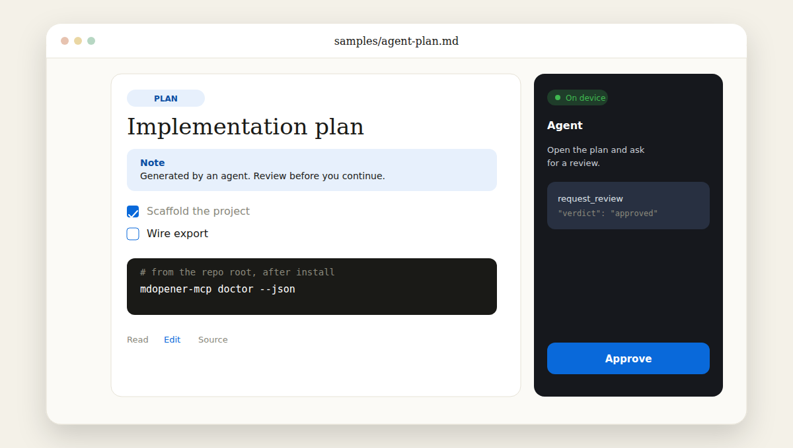
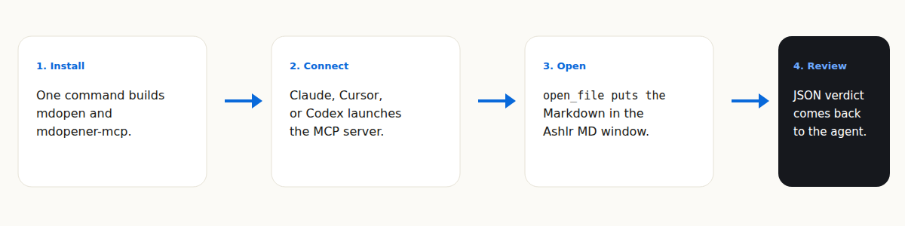
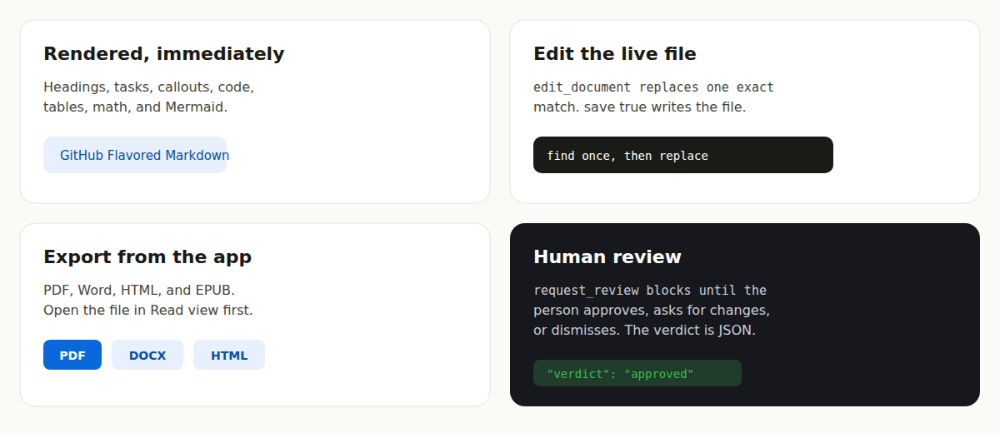

<div align="center">


# Ashlr MD

**The Markdown app agents can drive.**

Ashlr MD opens `.md` files on macOS, Windows, and Linux, and it speaks [MCP](https://modelcontextprotocol.io/). An agent can install the CLI, open a document, edit it, export it, and wait for a person to approve it.

People get a rendered page instead of raw syntax. Agents get `mdopen`, `mdopener-mcp`, and JSON on stdout.

<!-- fresh:begin version-badge -->
[](https://github.com/ashlrai/ashlr-md/releases/tag/v0.4.0)
<!-- fresh:end -->

[](https://github.com/ashlrai/ashlr-md/actions/workflows/ci.yml)
[](./LICENSE)
[](https://github.com/ashlrai/ashlr-md/stargazers)
[](#download)
[](https://tauri.app)

[llms.txt](./llms.txt) ·
[llms-full.txt](./llms-full.txt) ·
[Examples](./docs/EXAMPLES.md) ·
[Agent guide](./docs/AGENTS.md) ·
[Keyboard shortcuts](./docs/SHORTCUTS.md) ·
[Website](https://md.ashlr.ai)

</div>

## Start

From a checkout, on macOS or Linux. One command builds the CLI and the MCP server, links both onto `PATH`, and registers Claude Code when `claude` is already installed.

```bash
SKIP_APP_BUILD=1 bash scripts/install.sh
```

No checkout yet:

```bash
SKIP_APP_BUILD=1 bash <(curl -fsSL https://raw.githubusercontent.com/ashlrai/ashlr-md/main/scripts/install.sh)
```

If the linker used `~/.local/bin` and your shell cannot find the commands yet: `export PATH="$HOME/.local/bin:$PATH"`.

JSON, from the same machine. These commands exit on their own. They do not download a model and they do not write config.

```bash
mdopener-mcp doctor --json
mdopener-mcp setup --local --json
mdopener-mcp --ashlr-handshake --json
mdopener-mcp --export-tool-schema
```

Connect the server. Each command uses the `mdopener-mcp` that is on `PATH`.

```bash
claude mcp add --scope user ashlr-md "$(command -v mdopener-mcp)"
codex mcp add ashlr-md -- "$(command -v mdopener-mcp)"
python3 scripts/connect-cursor.py
```

Open a file in the desktop app, after the app itself is installed:

```bash
mdopen samples/agent-plan.md
```

More commands, including Windows: [docs/EXAMPLES.md](./docs/EXAMPLES.md). Every tool, in order: [docs/AGENTS.md](./docs/AGENTS.md).

## 30-second start

For the desktop app, without a terminal.

1. Download the [latest release](https://github.com/ashlrai/ashlr-md/releases/latest) for your OS: `.dmg` (Apple Silicon), `.msi`/`-setup.exe` (Windows), `.deb`/`.rpm`/`.AppImage` (Linux).
2. Double-click any `.md` file, or run `mdopen notes.md` after **Preferences → Command-line tool → Install mdopen** (the app's installers leave `mdopen` off your `PATH`; see [docs/AGENTS.md](./docs/AGENTS.md#install)).
3. Ask the AI sidebar about it. On a Mac with Apple Silicon and macOS 26 or later, the built-in on-device model needs no account and no API key: turn on Apple Intelligence in System Settings, then restart Ashlr MD. On Windows and Linux, install [Ollama](https://ollama.com) for free local AI, or add an Anthropic API key in Preferences.



## How it works



1. `scripts/install.sh` builds `mdopen` and `mdopener-mcp` and links them onto `PATH`.
2. Claude Code, Cursor, or Codex launches `mdopener-mcp` over stdio.
3. `open_file` is the tool that starts the desktop app. The other tools use the document that is already open, or read a Markdown file from disk.
4. `request_review` waits for Approve, Request changes, or Dismiss. The agent gets that verdict as JSON.

The server talks to the app on `127.0.0.1` with a token in `~/.mdopener/`. Full contract: [docs/AGENTS.md](./docs/AGENTS.md).

## Features



- **Render.** GitHub Flavored Markdown, highlighted code, Mermaid, KaTeX, callouts, tables, and footnotes.
- **Edit.** A WYSIWYG editor and a source editor. `edit_document` replaces one exact match. `save: true` writes the file.
- **Export.** PDF, Word, HTML, and EPUB from the app. Call `open_file` with `"mode": "read"` before `export`.
- **Review.** `request_review` blocks until a person decides. `get_user_annotations` reads the verdict and the task checkboxes later.
- **Watch a folder.** The activity drawer (Command-B on macOS, Ctrl-B on Windows and Linux) lists new `.md` files as they appear.
- **On-device AI.** Apple Foundation Models on macOS 26 or later (Apple Silicon), or Ollama. A cloud model runs only if you opt in. Rules: [docs/local-ai.md](./docs/local-ai.md).
- **Obsidian, VS Code, and Raycast.** Each one opens the current note through `mdopener://`. Notes: [docs/OBSIDIAN.md](./docs/OBSIDIAN.md), [integrations/vscode](./integrations/vscode/), [integrations/raycast](./integrations/raycast/).

## Keyboard shortcuts

Shown with ⌘ on macOS; use **Ctrl** on Windows and Linux.

| Action | Shortcut |
|---|---|
| Command palette | `⌘K` |
| AI assistant | `⌘L` |
| Inline AI rewrite (in editor) | `⌘I` |
| Cycle theme | `⌘⇧L` |
| Open file | `⌘O` |
| Save | `⌘S` |
| Export | `⌘E` |
| Copy as rich text | `⌘⇧C` |
| Insert table | `⌘⇧T` |
| Read / Edit / Source view | `⌘1` / `⌘2` / `⌘3` |
| Find in document | `⌘F` |
| Find & replace (source) | `⌘⌥F` |
| Search across files | `⌘⇧F` |
| Split preview | `⌘\` |
| Zen mode | `⌘⇧Z` |
| Next / Previous tab | `⌘⇧]` / `⌘⇧[` |
| Close tab | `⌘W` |
| Agent activity drawer | `⌘B` |
| Outline | `⌘⇧O` |
| Settings | `⌘,` |
| Keyboard shortcuts (cheat sheet) | `⌘/` |

## FAQ

### What do I run first?

`SKIP_APP_BUILD=1 bash scripts/install.sh`, then `mdopener-mcp doctor --json`. The desktop app is a separate download: [docs/INSTALL.md](./docs/INSTALL.md).

### Where is the tool list?

[docs/AGENTS.md](./docs/AGENTS.md), or `mdopener-mcp --export-tool-schema` for JSON.

### Does a model upload my files?

Apple's on-device model and a loopback Ollama stay on the machine. Cloud calls happen only after you add a key or turn on a hosted option. `"offline": true` in `~/.ashlr/config.json` refuses cloud calls. Details: [docs/local-ai.md](./docs/local-ai.md).

### Which computers have a release build?

Apple Silicon Macs, Windows x64, and Linux x86_64. The current release is unsigned. On macOS, right-click the app and choose Open the first time. Windows may show a SmartScreen warning. There is no Homebrew, winget, or AUR package yet. Intel Macs build from source. Steps: [docs/INSTALL.md](./docs/INSTALL.md).

### How does Phantom open a file?

[How Ashlr MD plugs into Phantom](#how-ashlr-md-plugs-into-phantom).

## Star Ashlr MD

If an agent on your machine should open Markdown in a real window, star the repo so the next person can find it.

[Star ashlrai/ashlr-md on GitHub](https://github.com/ashlrai/ashlr-md/stargazers)

## One-click agent setup

Open the app, then Preferences, then AI agents (MCP). Click **Connect to Claude Code**, **Connect to Cursor**, or **Connect to Codex**. Each button registers this app's `mdopener-mcp`. The terminal commands that do the same job are in [Start](#start).

Discovery metadata: [docs/mcp-registry.md](./docs/mcp-registry.md).

## Download

Release builds are on the [latest release](https://github.com/ashlrai/ashlr-md/releases/latest). Per-OS steps are in [docs/INSTALL.md](./docs/INSTALL.md). The app includes an updater. The installers do not put `mdopen` on `PATH`. Use Preferences, Command-line tool, Install mdopen, or the [install script](#start) on macOS and Linux.

## How Ashlr MD plugs into Phantom

[Phantom](https://phm.dev) hands Markdown to Ashlr MD (`phm inbox show <id> --open`, `phm digest --open`). It calls `mdopen` when Ashlr MD is installed, and prints in the terminal when it is not. On Phantom's `master` branch, that inbox and digest handoff is what is merged. The opener for any `.md`, and the `PHANTOM_ASHLR_MD=0` opt-out, are on Phantom's `feat/ashlr-md-opener` branch.

Three hooks stay stable:

| Hook | What Phantom does with it |
|---|---|
| `mdopen` on `PATH` | Means Ashlr MD is installed. `mdopen` exits 0 only when a viewer accepted the file ([exit status](./docs/PHANTOM.md#mdopen-exit-status)) |
| `mdopener://` | `mdopener://open?path=<url-encoded absolute path>` opens a file. Add `&mode=edit` for the editor |
| `mdopener-mcp` | Agents call `open_file` so a person can review the document |

Under `phantom exec -- <cmd>`, provider keys arrive as `phm_` placeholders and `ANTHROPIC_BASE_URL` points at the session proxy. The sidebar uses the key saved in Settings unless `ASHLR_MD_ANTHROPIC_KEY_FROM_ENV=1`, which reads `ANTHROPIC_API_KEY` from the environment. A `phm_` placeholder is honored only when the base URL is that proxy. `mdopener-mcp` sends no Anthropic requests. Ashlr MD never resolves a `phm:` reference. Do not copy a key into Settings with `phantom reveal`.

The full contract is in [docs/PHANTOM.md](./docs/PHANTOM.md). The URL rules are tested. The app has not been tested against a live `phantom exec` session.

Source: [ashlrai/phantom](https://github.com/ashlrai/phantom). Placeholders: [ashlrai/phantom-secrets](https://github.com/ashlrai/phantom-secrets).

## Local models

Chat can use Apple Foundation Models, Ollama, or a key you add in Preferences. URL rules, the `localInference` block, and offline mode: [docs/local-ai.md](./docs/local-ai.md). State-folder repairs: [docs/doctor-fix.md](./docs/doctor-fix.md).

```bash
mdopener-mcp doctor --fix --json
```

## Develop

Prerequisites: [Rust](https://rustup.rs) and [Bun](https://bun.sh). macOS also needs Xcode Command Line Tools (`xcode-select --install`). Windows needs the MSVC build tools. Linux needs a C toolchain and the [Tauri Linux packages](https://tauri.app/start/prerequisites/#linux).

```bash
bun install
bun run tauri dev
bun run typecheck
bun run lint
bun run test
bun run check:doc-links
bun run check:version
bun run check:workflow-bash
python3 scripts/check-docs.py
python3 scripts/test-mcp-setup.py
python3 scripts/test-connect-cursor.py
node --test scripts/check-readme-parity.test.mjs && node scripts/check-readme-parity.mjs
```

The optional on-device sidecar (macOS 26 or later):

```bash
cd src-tauri/bins/mdopener-afm && ./build.sh
```

| Layer | What |
|---|---|
| `src/` | React 19 frontend: renderer, editors, AI sidebar, export |
| `src-tauri/src/` | Rust core: files, watcher, deep links, AI proxy, loopback IPC |
| `src-tauri/bins/` | `mdopen`, `mdopener-mcp`, and the macOS Swift sidecars (`mdopener-afm`, `mdopener-setdefault`) |
| `landing/` | The marketing site |

Product goal: [docs/VISION.md](./docs/VISION.md). Releases: [docs/RELEASING.md](./docs/RELEASING.md).

## Part of Ashlr

Each tool installs on its own.

- [Phantom](https://phm.dev) (`phm`), the agent workbench. Source: [ashlrai/phantom](https://github.com/ashlrai/phantom).
- [Phantom Secrets](https://phm.dev/secrets) (`phantom`), `phm_` placeholders. Source: [ashlrai/phantom-secrets](https://github.com/ashlrai/phantom-secrets).
- [Locus](https://github.com/ashlrai/locus) (`locus`), one account per agent session.
- [Lexicon](https://lexicon.ashlr.ai) (`lexicon`), dictation corrections.
- [Ashlr Stack](https://stack.ashlr.ai) (`stack`), service provisioning.
- [ashlr-plugin](https://plugin.ashlr.ai/) (`ashlr-plugin`), token-efficiency tools.

Cryptography notes, with no quantum-safety claim: [docs/PQ-READINESS.md](./docs/PQ-READINESS.md).

## Contributing

See [CONTRIBUTING.md](./CONTRIBUTING.md). Local-first, no GPL in the bundle, and verify in the running app. Security reports: [SECURITY.md](./SECURITY.md). Roadmap: [ROADMAP.md](./ROADMAP.md).

## License

[MIT](./LICENSE) © Ashlr MD contributors
