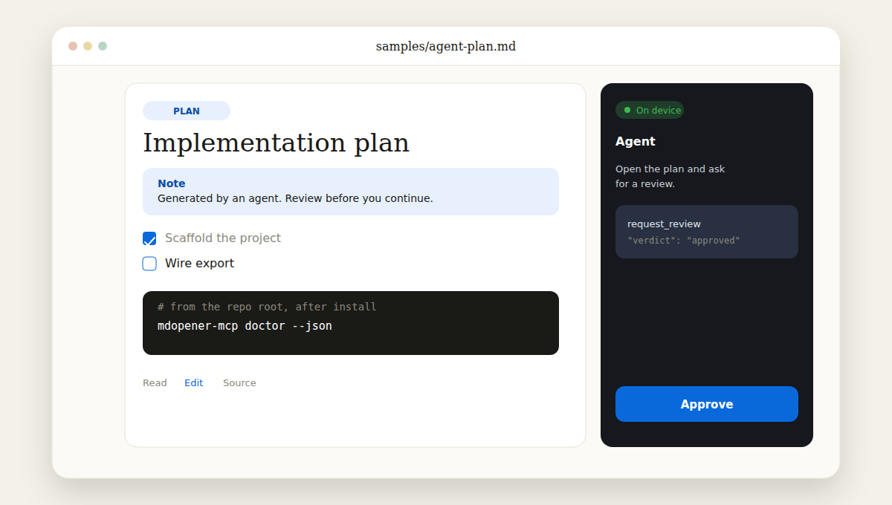
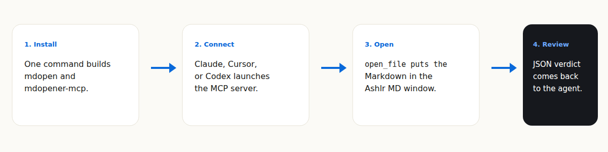
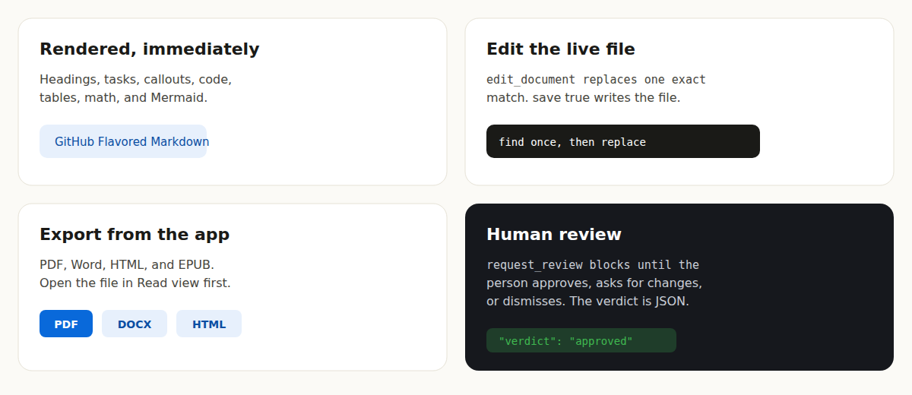

<div align="center">


# Ashlr MD

**The Markdown app agents can drive.**

Ashlr MD opens `.md` files on macOS, Windows, and Linux, and it speaks [MCP](https://modelcontextprotocol.io/). An agent can install the CLI, open a document, edit it, export it, and wait for a person to approve it.

People get a rendered page instead of raw syntax. Agents get `mdopen`, `mdopener-mcp`, and JSON on stdout.

<!-- fresh:begin version-badge -->
[](https://github.com/ashlrai/ashlr-md/releases/tag/v0.7.5)
<!-- fresh:end -->

[](https://github.com/ashlrai/ashlr-md/actions/workflows/ci.yml)
[](./LICENSE)
[](https://github.com/ashlrai/ashlr-md)
[](#download)
[](https://tauri.app)

[llms.txt](./llms.txt) ·
[llms-full.txt](./llms-full.txt) ·
[Examples](./docs/EXAMPLES.md) ·
[Agent guide](./docs/AGENTS.md) ·
[Keyboard shortcuts](./docs/SHORTCUTS.md) ·
[Website](https://md.ashlr.ai)

</div>

## Get started

Five steps. Each one says what you should see.

1. **Install.** From a checkout, on macOS or Linux. This builds `mdopen` and `mdopener-mcp` and links both onto `PATH`:

   ```bash
   SKIP_APP_BUILD=1 bash scripts/install.sh
   ```

   You should see `Installation complete.` and a short "Next steps" list. No checkout yet? The same script clones the repository into `~/ashlr-md`:

   ```bash
   SKIP_APP_BUILD=1 bash <(curl -fsSL https://raw.githubusercontent.com/ashlrai/ashlr-md/main/scripts/install.sh)
   ```

   Git, curl, Rust, Cargo, and Bun are required. If your shell cannot find the commands afterwards, run `export PATH="$HOME/.local/bin:$PATH"`.

2. **Check.** This looks only at this machine. It downloads nothing and writes no config:

   ```bash
   mdopener-mcp doctor --json
   ```

   You should see JSON with a `checks` list. The command exits `0`.

3. **Connect your agent.** The installer registers Claude Code when `claude` is installed. To add it yourself:

   ```bash
   claude mcp add --scope user ashlr-md "$(command -v mdopener-mcp)"
   ```

   You should see `ashlr-md` in `claude mcp list`. For Codex, run `codex mcp add ashlr-md -- "$(command -v mdopener-mcp)"`. For Cursor, run `python3 scripts/connect-cursor.py` from this checkout.

4. **Open a file.** Do this after the app itself is installed ([Download](#download)):

   ```bash
   mdopen samples/agent-plan.md
   ```

   You should see the plan rendered in an Ashlr MD window. `mdopen` starts the installed app if it is closed. If no window appears, read stderr, start Ashlr MD and retry; see the [exit-status notes](./docs/EXAMPLES.md#open-a-file).

5. **Ask for review.** Your agent calls `request_review` on a document. The document stays open for you, and your verdict goes back to the agent as JSON.

Next: [Commands and flags](#commands-and-flags) lists every command, [MCP tools](#mcp-tools) lists every tool, and [docs/AGENTS.md](./docs/AGENTS.md) is the full guide. Windows examples: [docs/EXAMPLES.md](./docs/EXAMPLES.md).

## Commands and flags

Each command prints its full list with `--help`.

**`mdopen`** opens a file in the app.

| Flag | What it does |
|---|---|
| `file.md` | Open the file in read mode |
| `--edit`, `-e` | Open in edit mode |
| `--read`, `-r` | Open in read mode. This is the default. Do not combine it with `--edit` |
| `-` | Read Markdown from stdin and open it |
| `--` | Stop reading flags. Put it before a file whose name starts with a dash |
| `--hook` | Claude Code hook. Reads the hook's JSON from stdin, not a file |
| `--help`, `-h` | Print help |
| `--version`, `-V` | Print the version |

**`mdopener-mcp`** is the MCP server. Your MCP client starts it, so you rarely run it by hand.

Add `--json` to `--version`, `--help`, or `--export-tool-schema` for one JSON
object with `kind`, `schema_version: 1`, and the command's fields.
See the [agent guide](./docs/AGENTS.md) for the output contract.

| Command | What it does |
|---|---|
| `mdopener-mcp` | Serve MCP over stdin and stdout |
| `doctor [--json]` | Check the local AI server. It talks only to this machine and sends no key |
| `doctor --fix [--apply] [--json]` | Preview repairs to `~/.mdopener`. Add `--apply` to make them |
| `setup --local [--json]` | Find local model servers and print the commands to finish. Downloads and writes nothing |
| `--ashlr-handshake [--json]` | Print the companion handshake |
| `--export-tool-schema` | Print the tool names and input schemas as JSON |
| `--help`, `--version` | Print help or the version |

Other arguments to `mdopener-mcp` are ignored, with a warning on stderr.

## MCP tools

The server exposes these 20 tools, in the order the server lists them. Input schemas: `mdopener-mcp --export-tool-schema`. Parameters and return values: [docs/AGENTS.md](./docs/AGENTS.md#mcp-tool-reference).

| Tool | What it does |
|---|---|
| `open_file` | Open a file in the app. Pass `"mode": "edit"` to edit |
| `get_current_content` | Get the path and full Markdown of the open document |
| `list_recent` | List recently opened files, newest first |
| `request_review` | Ask a person to approve or request changes. Blocks until they decide |
| `get_user_annotations` | Read the latest verdict, comments, and task checkboxes |
| `edit_document` | Replace one exact, unique match in the open document |
| `search_vault` | Search the watched folder and recent files |
| `present_document` | Switch the app to a distraction-free reading view |
| `list_ai_actions` | List the editor's AI actions, such as explain or summarize |
| `get_conversation_context` | Read the latest messages in the AI sidebar |
| `save_conversation_message` | Save a message to the AI sidebar conversation |
| `diff_documents` | Show a unified diff of two Markdown files on disk |
| `stream_edit` | Preview a find and replace as a diff. Changes nothing |
| `stream_edit_apply` | Apply a previewed `stream_edit`, chosen by occurrence |
| `export_text` | Get the plain text of a Markdown file, with syntax removed |
| `export_metadata` | Get the headings and other structure of a Markdown file |
| `edit_canvas` | Apply typed edits to a `.canvas` file, all or nothing |
| `export` | Export the open document in one of the app's formats |
| `replace_document` | Replace the entire content of the open document |
| `set_content` | Replace the entire content of the open document. Same as `replace_document` |

The server also serves resources (`mdopener://current`, `text://vault-search`, `mdopener://recent-documents`, and a `file://` entry for each watched-folder file) and three prompts (`summarize`, `review_plan`, `improve_writing`) that embed the open document. See [Resources](./docs/AGENTS.md#resources-reference) and [Prompts](./docs/AGENTS.md#prompts-reference).

## One-click agent setup

Open the app, then Preferences, then AI agents (MCP). Click **Connect to Claude Code**, **Connect to Cursor**, or **Connect to Codex**. Each button registers this app's `mdopener-mcp`. The terminal commands that do the same job are in [Get started](#get-started).

Discovery metadata: [docs/mcp-registry.md](./docs/mcp-registry.md).

## Download

The desktop app needs no terminal.

1. Download the [latest release](https://github.com/ashlrai/ashlr-md/releases/latest) for your OS: `.dmg` (`aarch64` for Apple Silicon, `x64` for Intel), `.msi`/`-setup.exe` (Windows), `.deb`/`.rpm`/`.AppImage` (Linux). Per-OS steps are in [docs/INSTALL.md](./docs/INSTALL.md). The app includes an updater.
2. Double-click any `.md` file. The installers do not put `mdopen` on `PATH`. To run `mdopen notes.md`, use Preferences, Command-line tool, Install mdopen, or the [install script](#get-started) on macOS and Linux ([details](./docs/AGENTS.md#install)).
3. Ask the AI sidebar about it. On a Mac with Apple Silicon and macOS 26 or later, the built-in on-device model needs no account and no API key: turn on Apple Intelligence in System Settings, then restart Ashlr MD. On Windows and Linux, install [Ollama](https://ollama.com) for free local AI, or add an Anthropic API key in Preferences.



Illustration of the review flow; the app interface may differ.

## How it works



1. `scripts/install.sh` builds `mdopen` and `mdopener-mcp` and links them onto `PATH`.
2. Claude Code, Cursor, or Codex launches `mdopener-mcp` over stdio.
3. `open_file` is the tool that starts the desktop app. The other tools use the document that is already open, or read a Markdown file from disk.
4. `request_review` waits for a decision, returning JSON. If the call returns `pending`, resume it by passing the returned `reviewId` as `review_id`; reviews can also time out or be superseded.

The server talks to the app on `127.0.0.1` with a token in `~/.mdopener/`. Full contract: [docs/AGENTS.md](./docs/AGENTS.md).

## Features



- **Render.** GitHub Flavored Markdown, highlighted code, Mermaid, KaTeX, callouts, tables, and footnotes.
- **Edit.** A WYSIWYG editor and a source editor. `edit_document` replaces one exact match. `save: true` writes the file.
- **Export.** PDF, Word, HTML, and EPUB from the app. Call `open_file` with `"mode": "read"` before `export`.
- **Review.** `request_review` waits for a person by default and can return a pending review to resume. `get_user_annotations` reads the verdict and task checkboxes later.
- **Watch a folder.** The activity drawer (Command-B on macOS, Ctrl-B on Windows and Linux) lists new `.md` files as they appear.
- **Search your library.** The AI sidebar can retrieve relevant text from Markdown files in watched folders, using keyword search and optional embeddings. See [docs/local-ai.md](./docs/local-ai.md).
- **On-device AI.** Apple Foundation Models on macOS 26 or later (Apple Silicon), or Ollama. A cloud model runs only if you opt in. Rules: [docs/local-ai.md](./docs/local-ai.md).
- **Obsidian, VS Code, and Raycast.** Open notes through `mdopener://`; VS Code can fall back to `mdopen`. Notes: [docs/OBSIDIAN.md](./docs/OBSIDIAN.md), [integrations/vscode](./integrations/vscode/), [integrations/raycast](./integrations/raycast/).

## Keyboard shortcuts

Shown with ⌘ on macOS; use **Ctrl** on Windows and Linux.

| Action | Shortcut |
|---|---|
| Command palette | `⌘K` |
| AI assistant | `⌘L` |
| Inline AI rewrite (in editor) | `⌘I` |
| Cycle theme | `⇧⌘L` |
| Open file | `⌘O` |
| Save | `⌘S` |
| Export | `⌘E` |
| Copy as rich text | `⇧⌘C` |
| Insert table | `⇧⌘T` |
| Read / Edit / Source view | `⌘1` / `⌘2` / `⌘3` |
| Find in document | `⌘F` |
| Find & replace (source) | `⌥⌘F` |
| Search across files | `⇧⌘F` |
| Split preview | `⌘\` |
| Zen mode | `⇧⌘Z` |
| Next / Previous tab | `⇧⌘]` / `⇧⌘[` |
| Close tab | `⌘W` |
| Agent activity drawer | `⌘B` |
| Outline | `⇧⌘O` |
| Settings | `⌘,` |
| Keyboard shortcuts (cheat sheet) | `⌘/` |

## FAQ

### What do I run first?

`SKIP_APP_BUILD=1 bash scripts/install.sh`, then `mdopener-mcp doctor --json`. The desktop app is a separate download: [docs/INSTALL.md](./docs/INSTALL.md).

### Where is the tool list?

[docs/AGENTS.md](./docs/AGENTS.md), or `mdopener-mcp --export-tool-schema` for JSON.

### Does a model upload my files?

Apple's on-device model and a loopback Ollama stay on the machine. Cloud calls happen only after you add a key or turn on a hosted option. `"offline": true` in `~/.ashlr/config.json` refuses cloud calls. Details: [docs/local-ai.md](./docs/local-ai.md).

### Which computers have a release build?

Macs (Apple Silicon and Intel), Windows x64, and Linux x86_64. The current release is unsigned. On macOS, right-click the app and choose Open the first time. Windows may show a SmartScreen warning. There is no Homebrew, winget, or AUR package yet. Steps: [docs/INSTALL.md](./docs/INSTALL.md).

### How does Phantom open a file?

[How Ashlr MD plugs into Phantom](#how-ashlr-md-plugs-into-phantom).

## How Ashlr MD plugs into Phantom

[Phantom](https://phm.dev) hands Markdown to Ashlr MD (`phm inbox show <id> --open`, `phm digest --open`). It calls `mdopen` when Ashlr MD is installed, and prints in the terminal when it is not. On Phantom's `master` branch, that inbox and digest handoff is what is merged. The opener for any `.md`, and the `PHANTOM_ASHLR_MD=0` opt-out, are on Phantom's `feat/ashlr-md-opener` branch.

Three hooks stay stable:

| Hook | What Phantom does with it |
|---|---|
| `mdopen` on `PATH` | Means Ashlr MD is installed. `mdopen` exits 0 only when a viewer accepted the file ([exit status](./docs/PHANTOM.md#mdopen-exit-status)) |
| `mdopener://` | `mdopener://open?path=<url-encoded absolute path>` opens a file. Add `&mode=edit` for the editor |
| `mdopener-mcp` | Agents call `open_file` so a person can review the document |

Under `phantom exec -- <cmd>`, provider keys arrive as `phm_` placeholders and `ANTHROPIC_BASE_URL` points at the session proxy. The sidebar uses the key saved in Settings unless `ASHLR_MD_ANTHROPIC_KEY_FROM_ENV=1`, which reads `ANTHROPIC_API_KEY` from the environment. A `phm_` placeholder is honored only when the base URL is that proxy. `mdopener-mcp` sends no Anthropic requests. Ashlr MD never resolves a `phm:` reference. Do not copy a key into Settings with `phantom reveal`.

The full contract is in [docs/PHANTOM.md](./docs/PHANTOM.md). The URL rules are tested. The app has not been tested against a live `phantom exec` session.

Source: [ashlrai/phantom](https://github.com/ashlrai/phantom). Placeholders: [ashlrai/phantom-secrets](https://github.com/ashlrai/phantom-secrets).

## Local models

Chat can use Apple Foundation Models, Ollama, or a key you add in Preferences. URL rules, the `localInference` block, and offline mode: [docs/local-ai.md](./docs/local-ai.md). State-folder repairs: [docs/doctor-fix.md](./docs/doctor-fix.md).

```bash
mdopener-mcp doctor --fix --json
```

That command only previews the repairs. Add `--apply` to make them.

## Develop

Prerequisites: [Rust](https://rustup.rs) and [Bun](https://bun.sh) build the app. macOS also needs Xcode Command Line Tools (`xcode-select --install`). Windows needs the MSVC build tools. Linux needs a C toolchain and the [Tauri Linux packages](https://tauri.app/start/prerequisites/#linux). The checks below also need [Node.js](https://nodejs.org) and Python 3, and the secret-shape scan needs Perl. The full list is in [CONTRIBUTING.md](./CONTRIBUTING.md#prerequisites). `--frozen-lockfile` installs what `bun.lock` pins, as CI does; only a change that adds or bumps a dependency runs plain `bun install`.

```bash
bun install --frozen-lockfile
bun run tauri dev
bun run typecheck
bun run lint
bun run test
bun run check:doc-links
bun run check:version
bun run fresh:check
bun run doclive:check
bun run check:workflow-bash
python3 scripts/check-docs.py
python3 scripts/test-mcp-setup.py
python3 scripts/test-connect-cursor.py
node --test scripts/check-readme-parity.test.mjs && node scripts/check-readme-parity.mjs
```

The optional on-device sidecar (macOS 26 or later):

```bash
cd src-tauri/bins/mdopener-afm && ./build.sh
```

| Layer | What |
|---|---|
| `src/` | React 19 frontend: renderer, editors, AI sidebar, export |
| `src-tauri/src/` | Rust core: files, watcher, deep links, AI proxy, loopback IPC |
| `src-tauri/bins/` | `mdopen`, `mdopener-mcp`, and the macOS Swift sidecars (`mdopener-afm`, `mdopener-setdefault`) |
| `integrations/` | Editor companions that open a file in Ashlr MD: the [Obsidian plugin](./integrations/obsidian/), [VS Code extension](./integrations/vscode/), and [Raycast extension](./integrations/raycast/) |
| `packaging/` | Homebrew, winget, and AUR package definitions. None is published yet ([docs/INSTALL.md](./docs/INSTALL.md)) |
| `landing/` | The marketing site |

Product goal: [docs/VISION.md](./docs/VISION.md). Releases: [docs/RELEASING.md](./docs/RELEASING.md).

## Part of Ashlr

Phantom and its ecosystem form a fully autonomous, code-first, agent-native software factory. Agents run it; the human is a passive board member. The goal is open source RSI (recursive self improvement): agents that keep improving the tools they work with, these repositories included.

Ashlr MD is the factory's Markdown surface. It is where an agent hands a document to a person (Phantom's inbox and digest open here), and where an agent opens, edits, exports, and waits for approval over MCP.

Each tool installs on its own.

- [Phantom](https://phm.dev) (`phm`), the agent workbench. Source: [ashlrai/phantom](https://github.com/ashlrai/phantom).
- [Phantom Secrets](https://phm.dev/secrets) (`phantom`), `phm_` placeholders. Source: [ashlrai/phantom-secrets](https://github.com/ashlrai/phantom-secrets).
- [Locus](https://github.com/ashlrai/locus) (`locus`), one account per agent session.
- [Lexicon](https://lexicon.ashlr.ai) (`lexicon`), dictation corrections.
- [Ashlr Stack](https://stack.ashlr.ai) (`stack`), service provisioning.
- [ashlr-plugin](https://plugin.ashlr.ai/) (`ashlr-plugin`), token-efficiency tools.

Cryptography notes, with no quantum-safety claim: [docs/PQ-READINESS.md](./docs/PQ-READINESS.md).

### How agents work on this repository

Agents maintain Ashlr MD. Phantom (`phm improve`) and other coding agents open pull requests, merge them once the required checks pass, and fix `main` forward. Their rules are in [AGENTS.md](./AGENTS.md), and the checks every change must pass are in [CONTRIBUTING.md](./CONTRIBUTING.md#quality-gates-all-must-pass). People contribute the same way: [Contribute with an agent](./CONTRIBUTING.md#contribute-with-an-agent) walks through fork, branch, local checks, pull request and auto-merge.

## Star Ashlr MD

If an agent on your machine should open Markdown in a real window, star the repo so the next person can find it.

[Star ashlrai/ashlr-md on GitHub](https://github.com/ashlrai/ashlr-md)

## Contributing

See [CONTRIBUTING.md](./CONTRIBUTING.md). Point your coding agent at [AGENTS.md](./AGENTS.md) and [llms.txt](./llms.txt) first. Before you push, `scripts/ci-local.sh` runs the gates your diff needs; from a fork clone, pass the upstream main branch as its base ref. It does not run the two diff secret scans or five steps of the required check's fast job, among them `bun run test:unit`, whose punctuation test fails on an em or en dash even in Markdown docs. [Contribute with an agent](./CONTRIBUTING.md#contribute-with-an-agent) lists those commands. `Check (Linux)` is the one required check, and a green pull request merges through auto-merge and the merge queue; on a fork pull request a maintainer or fleet agent arms auto-merge for you. Local-first, no GPL in the bundle, and verify in the running app. Security reports: [SECURITY.md](./SECURITY.md). Roadmap: [ROADMAP.md](./ROADMAP.md).

## License

[MIT](./LICENSE) © Ashlr MD contributors
